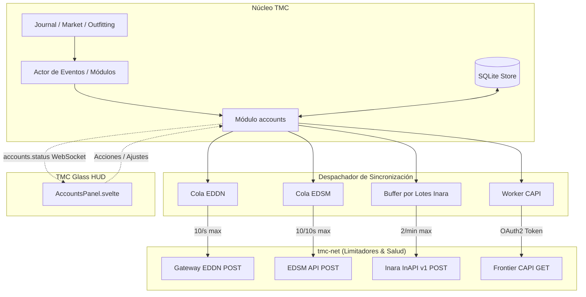

# TMC · Especificación de F6 — Cuentas y Sincronización Externa (EDDN, EDSM, Inara, Frontier CAPI)

- **Estado:** 🔄 en propuesta / pendiente de aprobación del propietario
- **Fecha:** 2026-10-23
- **Rama:** `fase/f6-cuentas-sincronizacion`
- **Depende de:**
  - [`2026-10-17-tmc-arquitectura-y-f0-design.md`](2026-10-17-tmc-arquitectura-y-f0-design.md) (Arquitectura y cimientos).
  - F1 ([`2026-10-17-tmc-f1-navegacion-exploracion-exobiologia-design.md`](2026-10-17-tmc-f1-navegacion-exploracion-exobiologia-design.md): Spansh, EDSM fallback).
  - F3 ([`2026-10-19-tmc-f3-comercio-misiones-design.md`](2026-10-19-tmc-f3-comercio-misiones-design.md): Consumo ZeroMQ de EDDN y mercados).
  - F4 ([`2026-10-21-tmc-f4-ingenieros-materiales-design.md`](2026-10-21-tmc-f4-ingenieros-materiales-design.md): Inventario de materiales, taquilla de a pie y naves).
  - F5 ([`2026-10-23-tmc-f5-carrier-colonizacion-powerplay-design.md`](2026-10-23-tmc-f5-carrier-colonizacion-powerplay-design.md): Fleet Carrier, Colonización y Powerplay 2.0).
  - Guía normativa de diseño: [`docs/design-system-glass-hud.md`](../design-system-glass-hud.md) y filosofía Companion [`AGENTS.md` §0](../../AGENTS.md).

---

## 1. Intención y filosofía de Companion

En el ecosistema de *Elite Dangerous*, los comandantes tradicionalmente necesitan ejecutar de 3 a 5 aplicaciones auxiliares simultáneas (EDMC para enviar a EDDN e Inara, EDDiscovery para EDSM, navegadores con 15 pestañas abiertas). Esto consume memoria, satura la barra de tareas y crea fricción innecesaria.

TMC (**The Multipurpose Companion**) resuelve esta fragmentación centralizando la comunicación con los cuatro pilares comunitarios y oficiales del juego en un único proceso ligero (< 150 MB de RAM y < 1 % CPU en reposo):

1. **Colaboración galáctica sin esfuerzo con EDDN (Elite Dangerous Data Network):** Envío automático y respetuoso de mercados (`commodity/3`), eventos de salto y exploración (`journal/1`), equipamiento (`outfitting/2`) y astilleros (`shipyard/2`) para nutrir las bases de datos abiertas de toda la comunidad (Spansh, Inara, Ardent, EDCD).
2. **Bitácora universal con EDSM:** Registro continuo de saltos de sistema, primeros descubrimientos, rangos y créditos.
3. **Presencia y prestigio en Inara:** Sincronización bidireccional del perfil del comandante, naves, componentes de ingeniería, taquilla de a pie de Odyssey y progreso en Community Goals, respetando escrupulosamente su cuota estricta de 2 peticiones/minuto.
4. **Telemetría oficial remota con la CAPI de Frontier (OAuth2 PKCE):** Obtención de la flota completa almacenada en hangares repartidos por toda la galaxia, valores de naves y datos oficiales de Fleet Carrier sin requerir estar atracado en la estación.
5. **Privacidad y Consentimiento Innegociable:** TMC nunca envía datos de la galaxia **Legacy**, descarta automáticamente eventos privados (chat, amigos, saldos en canales no autorizados), seudonimiza el `uploaderID` con sal criptográfica única y permite *opt-in/opt-out* independiente y visible para cada servicio con un solo interruptor.

---

## 2. Objetivos, no objetivos y antiobjetivos

### Objetivos

1. **Emisor EDDN (`eddn_sender`):**
   - Serialización conforme a los esquemas oficiales JSON Schema de EDDN (`commodity/3`, `journal/1`, `outfitting/2`, `shipyard/2`, `navroute/1`).
   - Envío HTTP POST seguro al gateway oficial `https://eddn.edcd.io:4430/upload/`.
   - Sobre envelope estándar: `$schemaRef`, `header: { uploaderID, softwareName: "TMC", softwareVersion, gatewayTimestamp }`, `message`.
   - Generación de `uploaderID` seudonimizado determinista por comandante con sal aleatoria local generada en la primera ejecución y guardada en SQLite (privacidad garantizada).
   - Cola de envío asíncrona desacoplada con reintentos para no frenar el ciclo de lectura del diario ni la UI.
2. **Sincronización con EDSM (`edsm_sync`):**
   - Envío a `https://www.edsm.net/api-logs-v1/`:
     - `set-logs`: Saltos de sistema (`FSDJump`), fecha y coordenadas.
     - `set-commander-ranks`: Rangos de combate, comercio, exploración, exobiología, soldado y CQC.
     - `set-commander-credits`: Créditos disponibles, patrimonio y saldo de préstamos.
     - `set-commander-materials`: Inventario de materiales (Raw, Manufactured, Encoded).
   - Rate limiting: máximo 10 peticiones cada 10 segundos con backoff ante errores HTTP 429/403/503.
3. **Sincronización con Inara (`inara_sync`):**
   - Integración con InAPI v1 (`https://inara.cz/inapi/v1/`).
   - Empaquetado por lotes (*batching*): agregación de eventos en un único payload cada 30-60 segundos o al pulsar "Sincronizar ahora".
   - Eventos soportados: `setCommanderProfile`, `setCommanderShip`, `setCommanderShipLocker`, `setCommanderInventory`, `setCommanderFleetCarrier`, `setCommanderTravelLog`, `setCommanderCommunityGoalProgress`.
   - Límite innegociable de Inara: máximo 2 peticiones por minuto (`RateLimiter` específico).
4. **Frontier CAPI con OAuth2 + PKCE (`frontier_capi`):**
   - Implementación del protocolo OAuth2 PKCE contra `https://auth.frontierstore.net/`.
   - Generación criptográfica de `code_verifier` (aleatorio URL-safe de 64 bytes) y `code_challenge` (SHA-256 base64url).
   - Manejo del callback local en el servidor axum (`/api/auth/frontier/callback`) o mediante protocolo de deep link `tmc://auth`.
   - Almacenamiento seguro de `access_token` y `refresh_token` en SQLite `tmc-store`.
   - Renovación automática y transparente del token antes de expirar.
   - Consulta a `https://companion.orerve.net/profile` para extraer la flota global remota de naves del comandante.
   - Si no hay `TMC_CAPI_CLIENT_ID` definido, la app permite introducirlo en la UI o permanece en estado desacoplado sin fallos.
5. **Gestión de Cuentas y Estado (`tmc-modules` / `accounts`):**
   - Nuevo módulo `accounts` en `crates/tmc-modules/` que centraliza la configuración, orquesta la emisión según las preferencias y publica el topic WebSocket `accounts.status`.
6. **UI «TMC Glass HUD» de Cuentas y Sincronización:**
   - Panel de Cuentas accesible desde `TopBar` y pestaña lateral `Sidebar`.
   - 4 tarjetas Glass HUD dedicadas con píldoras de estado, interruptores, inputs seguros de API key (con visibilidad alternable) y métricas de actividad (mensajes enviados en sesión, última sincronización, tiempo hasta próximo slot de rate limit).
   - Explicaciones pedagógicas del Ayudante (Companion) sobre la utilidad de cada servicio y la política de privacidad.
7. **Localización e i18n:**
   - Cadenas en los 5 idiomas soportados (`es`, `en`, `fr`, `de`, `pt`) en `locales/*/accounts.ftl`.

### No objetivos

- No enviar datos de la galaxia **Legacy** (`Galaxy != Galaxy::Live`). Cualquier intento se aborta de inmediato con aviso en el log de diagnóstico.
- No enviar mensajes si `online_services == false` o si el interruptor del servicio específico está desactivado.
- No solicitar ni subir a git contraseñas en texto claro de Frontier (solo tokens OAuth2 PKCE).
- No implementar compras directas de ARX ni modificación de datos de cuenta en los servidores de Frontier.

### Antiobjetivos

- No usar llamadas bloqueantes que puedan congelar el actor de eventos ni la UI a 10 Hz.
- No superar nunca las cuotas de peticiones de los servicios comunitarios (especialmente el límite de 2 req/min de Inara).
- No introducir dependencias incompatibles con la licencia PolyForm Noncommercial 1.0.0.

---

## 3. Arquitectura y flujo de datos



### 3.1 Topic WebSocket `accounts.status`

```typescript
interface AccountsStatusTopic {
  eddn: {
    enabled: boolean;
    connected: boolean;
    uploader_id: string;
    messages_sent_session: number;
    last_upload_time: string | null;
    last_error: string | null;
  };
  edsm: {
    enabled: boolean;
    has_key: boolean;
    commander_name: string | null;
    last_sync_time: string | null;
    last_error: string | null;
    syncing: boolean;
  };
  inara: {
    enabled: boolean;
    has_key: boolean;
    commander_name: string | null;
    last_sync_time: string | null;
    last_error: string | null;
    pending_events: number;
    next_slot_secs: number;
    syncing: boolean;
  };
  capi: {
    configured: boolean;
    connected: boolean;
    commander_name: string | null;
    token_expires_at: string | null;
    remote_ships_count: number;
    last_sync_time: string | null;
    last_error: string | null;
  };
}
```

---

## 4. Contratos de Datos y Protocolos

### 4.1 EDDN Gateway Upload (`tmc-net/src/eddn_sender.rs`)
- **URL:** `https://eddn.edcd.io:4430/upload/`
- **Envelope:**
  ```json
  {
    "$schemaRef": "https://eddn.edcd.io/schemas/commodity/3",
    "header": {
      "uploaderID": "a1b2c3d4e5f6...",
      "softwareName": "TMC",
      "softwareVersion": "0.1.0",
      "gatewayTimestamp": "2026-10-23T12:00:00.000Z"
    },
    "message": { ... }
  }
  ```
- **Seudonimización:** `uploaderID = sha256_hex(format!("{}:{}", cmdr_name, local_salt))` donde `local_salt` es un UUIDv4 generado localmente si no existe.

### 4.2 Inara InAPI v1 (`tmc-net/src/inara.rs`)
- **URL:** `https://inara.cz/inapi/v1/`
- **Rate Limit:** Ventana estricta de 60 segundos con máx. 2 peticiones.
- **Envelope:**
  ```json
  {
    "header": {
      "appName": "TMC",
      "appVersion": "0.1.0",
      "isDeveloped": false,
      "APIkey": "usr_key_...",
      "commanderName": "CMDR Example"
    },
    "events": [
      {
        "eventName": "setCommanderProfile",
        "eventTimestamp": "2026-10-23T12:00:00Z",
        "eventData": { ... }
      }
    ]
  }
  ```

### 4.3 EDSM Logs API (`tmc-net/src/edsm_sync.rs`)
- **URL:** `https://www.edsm.net/api-logs-v1/<action>`
- **Rate Limit:** 10 peticiones por 10 segundos.
- **Acciones:** `set-logs`, `set-commander-ranks`, `set-commander-credits`, `set-commander-materials`.

### 4.4 Frontier OAuth2 PKCE (`tmc-net/src/capi.rs`)
- **Endpoints:**
  - Autorización: `https://auth.frontierstore.net/auth`
  - Token: `https://auth.frontierstore.net/token`
  - Perfil: `https://companion.orerve.net/profile`
- **Parámetros PKCE:**
  - `code_verifier`: 64 caracteres de entropía alta.
  - `code_challenge`: `base64url(sha256(code_verifier))`.
  - `code_challenge_method`: `S256`.
  - `redirect_uri`: `http://localhost:47320/api/auth/frontier/callback` o `tmc://auth`.

---

## 5. Criterios de Aceptación (Verificables)

1. **C1 — Esquemas EDDN:** El emisor genera envelopes válidos con `$schemaRef`, cabecera y cuerpo conforme a la especificación de EDDN para `commodity/3`, `journal/1`, `outfitting/2` y `shipyard/2`.
2. **C2 — Seudonimización y Privacidad:** El `uploaderID` de EDDN es seudo-anónimo, determinista por comandante pero sin exponer el nombre real ni el FID del jugador.
3. **C3 — Filtro de Galaxia Legacy y Opt-Out:** En ningún caso se envían peticiones a EDDN, EDSM, Inara o CAPI si la galaxia es `Legacy`, si `online_services` es falso, o si el servicio individual está desactivado.
4. **C4 — Límite de Inara (2 req/min):** El limitador de peticiones de Inara no permite bajo ninguna circunstancia más de 2 peticiones en cualquier ventana deslizante de 60 segundos, encolando y agrupando eventos en lotes.
5. **C5 — Límite de EDSM (10 req/10s):** Las peticiones a EDSM respetan la tasa de 10 peticiones en 10 segundos con degradación ante errores HTTP 429/403.
6. **C6 — Protocolo PKCE CAPI:** Generación y verificación correcta de `code_verifier` y `code_challenge` S256, canje del código de autorización por tokens y renovación con `refresh_token`.
7. **C7 — Almacenamiento seguro en SQLite:** Las credenciales (API keys de Inara/EDSM, tokens OAuth2 y sal de anonimización) se persisten en tablas seguras de `tmc-store` sin ser expuestas en archivos de registro ni en commits.
8. **C8 — Telemetría de Flota CAPI:** La consulta a `/profile` extrae con éxito la lista de naves remotas del comandante (modelo, estación donde está guardada, valor y distancia estimada).
9. **C9 — Interfaz Glass HUD y Ayudante:** Panel interactivo `AccountsPanel.svelte` con información de estado en vivo, inputs seguros, switches reactivos, botón "Sincronizar ahora" con temporizador de cooldown y mensajes claros del Ayudante.
10. **C10 — i18n y Rendimiento:** Localización completa en `es`, `en`, `fr`, `de`, `pt` con tests simétricos. Consumo global en reposo < 150 MB y < 1 % CPU.
